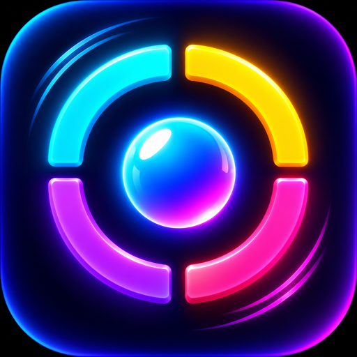

<div align="center">



# ORYVEX

### Find your color. Break the orbit.

A fast, neon, one-tap arcade game that runs in your browser and installs like a real app.
Pure **HTML5 Canvas + vanilla JavaScript** — no frameworks, no ads, no downloads.

[](https://moizgujjar7889-eng.github.io/)


</div>

---

## How to play

Tap to bounce your ball upward. Gravity pulls it back down. You can only pass through the parts of an obstacle that **match your ball's color** — touch any other color and the run ends.

- Grab **✦ stars** to score points and fill your wallet.
- Hit the **four-color orb** to change your ball's color.
- Every **5 obstacles** = a new level with new shapes and faster spins.

## Game modes

| Mode | What it is |
|------|-----------|
| **Classic** | One life. The pure neon climb. |
| **Infinity** | Three lives. A wrong color costs a life, not the run. |
| **Hard** | Faster spins, tighter gaps. One life. |
| **Daily** | Same course for everyone today. Come back every day for streak rewards. |

## Features

- 4 game modes with separate best scores
- 16 collectible ball skins and 9 trails, bought with stars
- 11 achievements with star rewards
- Daily reward with a 7-day streak
- Global leaderboard (Firebase, optional)
- Original synth music (rendered once into a light loop, so the game stays smooth) and sound effects, on **separate music and sound buses with their own volume sliders**
- **Every color has its own sound**: touching blue, yellow, purple or pink plays a different note
- Vibration is **off by default** and can be switched on in Settings
- Sharp, clean graphics on every screen (scales with your phone's pixel density, up to 2x; drops to 1.5x on slow phones)
- "Reduce effects" option for older phones
- Save backup: export and import your progress with a code
- Installable PWA — add to Home Screen and play offline

## Controls

| Device | Action |
|--------|--------|
| Phone | Tap anywhere |
| PC | Click, `Space`, `↑` or `W` |
| Pause | `Esc` or `P` |

## Install on your phone

1. Open the game link in Chrome (Android) or Safari (iPhone).
2. **Android:** tap the menu → **Install app**. **iPhone:** tap Share → **Add to Home Screen**.
3. Play from your home screen, even offline.

> **Music not starting?** Browsers only allow sound after your first tap. Tap once anywhere and the music begins. Check that **Music** is on and the volume sliders are up in ⚙ Settings.

## Run locally

PWA service workers need a web server (they don't work from `file://`):

```bash
python -m http.server 8000
```

Then open `http://localhost:8000`.

## Deploy on GitHub Pages

1. Create a repository (for example `oryvex-game`).
2. Upload **all files in this folder** to the repository root (not the ZIP itself).
3. Settings → Pages → **Deploy from a branch** → `main` / `(root)` → Save.
4. Open the Pages URL on your phone and install it.

> After uploading a new version, bump the `CACHE` name in `service-worker.js` (e.g. `oryvex-v17`) so players get the update.

## Leaderboard setup

See [SETUP.md](SETUP.md) for the Firebase Firestore rules and key restrictions.

## Project files

| File | Purpose |
|------|---------|
| `index.html` | Game, styles and logic |
| `service-worker.js` | Offline support and caching |
| `manifest.json` | PWA install info |
| `logo.png`, `icon-*.png`, `favicon*`, `og-image.png` | Branding and icons |

## Regenerate icons

```bash
magick logo.png -resize 192x192 icon-192.png
magick logo.png -resize 512x512 icon-512.png
```

---

<div align="center">

**Made with ♥ — tap, match, climb.**

</div>
